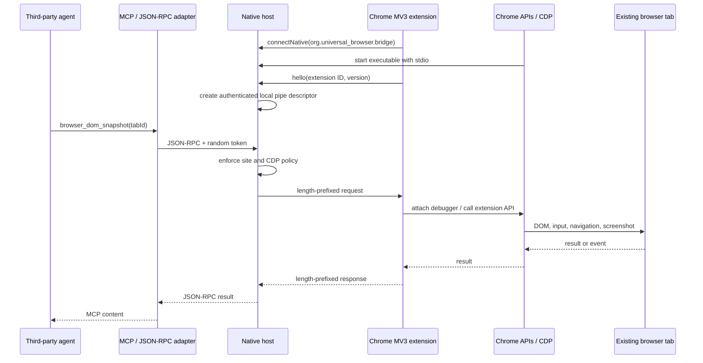

# Architecture

## Design objective

The project mirrors the observable layered process of the current Codex Chrome integration while replacing every proprietary component with independently written code and open platform interfaces.

## Components

### Chrome extension

`extension/background.js` is a Manifest V3 service worker. It initiates Chrome Native Messaging, dispatches browser methods, keeps a bounded debugger-event buffer, and adds an extension-local blocklist and kill switch.

Before attaching `chrome.debugger`, the service worker dynamically injects a foreign-extension-frame monitor only into the tab being controlled. The monitor navigates iframe/frame elements whose source belongs to another extension to `about:blank`, then removes each element after the safe navigation commits. This includes frames added later or placed inside already-discovered open or closed shadow roots. Chrome checks both the committed URL and the frame's security principal when granting debugger access, so the bridge waits for the redirected frame to disappear before attaching.

Shadow roots are discovered during initial scanning and observable DOM mutations. A new shadow root attached later to an already-connected host may remain undiscovered until a relevant rescan; this case is not guaranteed by the current implementation. The standard page path and an explicit web-accessible foreign-extension iframe path are validated on Chrome 152.

The extension uses two control planes:

1. Chrome extension APIs for tabs, tab groups, history, bookmarks, downloads, and Native Messaging.
2. `chrome.debugger` for CDP domains such as Runtime, Page, DOM, Accessibility, and Input.

The high-level locator API is implemented on top of DOM inspection plus CDP input dispatch. It intentionally exposes a smaller surface than upstream Playwright. Its typed read-only query layer mirrors the useful Codex collection/strict-query split: count and all-text operations accept collections, while inner text, text content, attribute, visibility and enabled-state operations enforce unique matches where applicable. These queries do not scroll, focus or dispatch input, and enforce bounded result sizes. Ordered frame paths resolve each iframe/frame element in a non-universal isolated world, map it to its CDP frame ID, and retain the loader chain only for the duration of one operation. Pointer coordinates are translated through each frame viewport, and every loader is revalidated before input. The Host separately authorizes every resolved cross-origin frame URL.

Element, URL and load-state waits use bounded timeouts and fresh document/frame resolution. Navigation expectations capture the top document identity and URL before executing one reviewed high-level action, then wait for a same-document URL change or replacement document before applying the selected load-state gate. `networkidle` enables Network observation and requires a 500ms zero-request window; it never waits indefinitely.

The Host assigns every client a non-secret session identity and owns the tab lease registry. Read-only calls can share a tab, while mutation calls require a renewable exclusive lease and still flow through the per-tab operation queue. Session-created and action-created tabs are tracked as temporary; explicit handoff/deliverable markers and unsaved-form inspection prevent unsafe automatic cleanup. Lease expiry and explicit session shutdown release ownership.

Download and file chooser waits subscribe before their reviewed click action, following the same ordering used by Codex Browser Use. Download completion is correlated with the new Page download event and Chrome download record. File chooser handles are tab-bound, single-use, and accept only Host-validated absolute regular files. Console entries are reduced to bounded primitive text at debugger-event time; object handles are discarded and source URLs are authorized and stripped of query/hash in the Host.

Debugger attachment injects a top-frame `lingee-agent-cursor` overlay at the viewport center before the first controlled action. Its closed Shadow DOM contains a persistent pointer and click pulse and uses `pointer-events: none`. A mutation observer restores the host if page code removes it. Navigation reinjects the centered pointer; semantic clicks, coordinate clicks, mouse moves, wheel coordinates, and drag steps update its position without hiding it. Script injection is best effort on restricted Chrome pages, so visual rendering never changes whether the underlying input action is allowed or dispatched. Detaching control removes the overlay and observer.

Responsive testing uses bounded `Emulation.setDeviceMetricsOverride` and `Emulation.clearDeviceMetricsOverride` calls behind high-level `getViewport`, `setViewport`, and `resetViewport` methods. The extension records only the active profile, re-reads layout metrics, and recenters the virtual pointer after every change. The Host tracks non-persistent overrides by session, transfers that ownership with a tab lease, and clears them before session cleanup; explicitly preserved profiles are not tracked for automatic reset.

Viewport PNG screenshots also create a 30-second observation record. It contains an opaque ID plus the tab, top document ID, layout/visual/content metrics signature, SHA-256 of a normalized DOM/layout snapshot, coordinate-safety flag, and current pointer-operation sequence. The normalizer excludes the Lingee cursor host and descendants so its own short feedback animation cannot invalidate page evidence. Before coordinate movement, click, drag, wheel, or scroll, the extension recaptures evidence inside the serialized tab operation and compares it before painting or dispatching input. Navigation, window/viewport/layout/content changes, a newer screenshot, any pointer operation, expiry, tab replacement/removal, or detach invalidates the record. The accepted action increments one tab-local operation sequence that is returned with the consumed observation and covers both overlay feedback and input dispatch.

Observed-resource export uses `Page.getResourceTree` and `Page.getResourceContent` only inside the extension. It assigns opaque IDs tied to the current top-level loader and invalidates the catalog on navigation, tab replacement, or removal. The Host rechecks every page and resource origin against site policy, enforces per-resource and aggregate byte limits, and writes an uncompressed ZIP plus manifest under a session-scoped temporary directory. No arbitrary fetch, request headers, cookies, page evaluation, or raw CDP entry point is exposed. Session end, expiry, and Host shutdown remove these archives.

### Native Messaging Host

`src/native-host.mjs` is bundled as a compact CommonJS application. On Windows, Chrome starts a small .NET Framework launcher from a manifest whose `allowed_origins` contains only the installed extension ID. The launcher reads an installer-generated `node-path.txt` and runs the Host with that exact system Node.js 22+ executable. The distributed Skill does not embed or download Node.js, and a missing recorded runtime fails closed rather than selecting an arbitrary PATH entry.

Native messages are JSON payloads preceded by a four-byte little-endian length. The host's stdout is reserved exclusively for this framing; logs go to stderr.

The host creates one authenticated local IPC endpoint per extension instance:

- Windows: named pipe
- macOS/Linux: Unix-domain socket

Descriptors are stored beneath the current user's application-data directory. They contain an instance ID, endpoint, process ID, creation time, and a random 256-bit bearer token.

### Bridge client

`src/bridge-client.mjs` discovers live descriptors, removes stale descriptors, selects the newest instance by default, and sends one newline-delimited JSON-RPC request per connection.

The explicit `UNIVERSAL_BROWSER_INSTANCE_ID` selection mechanism corresponds to choosing a particular Chrome extension/profile instance.

### MCP adapter

`src/mcp-server.mjs` implements MCP over stdio. It never receives browser credentials. It maps narrowly described tools to bridge methods and converts screenshots to MCP image content.

The standard high-level surface is declared once in `skills/lingee-chrome-control/scripts/runtime/standard-capabilities.mjs`. The repository MCP adapter imports its schemas directly, and the installed Skill CLI imports the same bundled module for its fail-closed method gate. Contract tests render the documented tool mapping from that registry and reject MCP, CLI, or documentation drift. Raw CDP and unknown methods are intentionally absent.

The browser session clipboard is deliberately implemented in the Native Host rather than through `navigator.clipboard` or operating-system APIs. Entries are held only in an in-memory map keyed by the validated Bridge session ID. Independent read and write policy gates default off; session end, expiry, and Host shutdown erase data. The Host validates the four-item/256-KiB bound, unique explicit MIME types, UTF-8 text encodings, canonical Base64, and PNG signature before storage. The extension advertises the stack capability and compatibility marker but never receives clipboard contents.

Resource ZIP creation is likewise Host-owned. Archive paths are session-temporary, never derived from a caller-supplied path, and contain only bytes returned for the selected current-document opaque IDs.

Consequential action intents are also Host-owned and memory-only. A prepared intent binds one approved tab, exact origin, declared action class, normalized summary/data types, exact allowlisted high-level action, session, creation/expiry time, and confirmation state. Confirmation never executes the action; execution atomically consumes it and recursively enters the same policy/lease/parameter checks. Exact-scope remembered approvals are hashed, session-local, and removed on session end. Direct file-input and captured-chooser assignment fail unless execution came from a confirmed upload intent. Other generic clicks cannot expose their business meaning to the Host, so the standard Skill/caller is responsible for declaring message, deletion, payment, permission and login intents.

### Policy

The Native Host is the authoritative enforcement point. Before forwarding a page command it resolves the tab's current URL and checks the effective site policy. Raw CDP uses a separate method allowlist. History, bookmark, and download metadata has an independent off-by-default switch.

The extension-side blocklist is defense in depth and can stop actions even when a third-party client possesses the runtime token.

## Request lifecycle

1. The agent calls a focused MCP tool or JSON-RPC method.
2. The adapter discovers the selected bridge instance and authenticates using its runtime descriptor.
3. The Native Host validates the method and parameters. Consequential operations additionally prepare/confirm/consume an exact action intent before this lifecycle continues.
4. For a tab-scoped command, the host first reads the tab URL and enforces site approval.
5. For raw CDP, the host checks the CDP method allowlist.
6. The host sends a Native Messaging request to the extension.
7. The extension applies its local enabled/blocklist settings.
8. The extension executes a Chrome API or CDP operation. Coordinate operations first validate and consume the screenshot observation, then bind overlay and input to one operation sequence.
9. The response returns over the same layers.
10. Page/debugger events are stored with monotonic cursors for later retrieval.

## Process and failure boundaries

- If Chrome closes the Native Messaging port, the host removes its descriptor and exits.
- If an MV3 service worker is suspended, the alarm/reconnect path recreates the Native Messaging connection.
- If a debugger is already attached by DevTools or another extension, Chrome may reject attachment; this is returned as a browser error.
- Debugger initialization is serialized per tab. A tab is recorded as attached only after `Page.enable` and `Runtime.enable` both succeed; partial initialization is detached and cleared before the error is returned.
- Explicit detach and asynchronous `onDetach` monitor cleanup form a barrier before another initialization. A late detach event cancels an in-flight initialization safely; Chrome events do not carry this controller's generation token, so a late event is not assumed to belong to an older session.
- Monitor injection confirms returned document IDs against a fresh frame inventory. Navigation retries are bounded; incomplete coverage fails before debugger attachment.
- A child frame observed as a foreign-extension frame is temporarily excluded while its safe `about:blank` navigation commits. The monitor then removes the element, and attachment waits until its frame ID disappears. Ordinary page-owned `about:blank` and all `about:srcdoc` documents receive monitors; the top frame always remains eligible.
- Page operations wait for an in-flight post-navigation monitor refresh. A failed refresh invalidates control and detaches the debugger before later operations can proceed.
- Navigation destroys document-scoped monitors, so controlled tabs reinstall the monitor on loading and frame commits. Explicit detach removes its observers. Removed frames are not restored automatically; reloading lets their owning extension recreate them.
- Requests default to a 30-second timeout.
- A stale descriptor is removed after connection probing fails.
